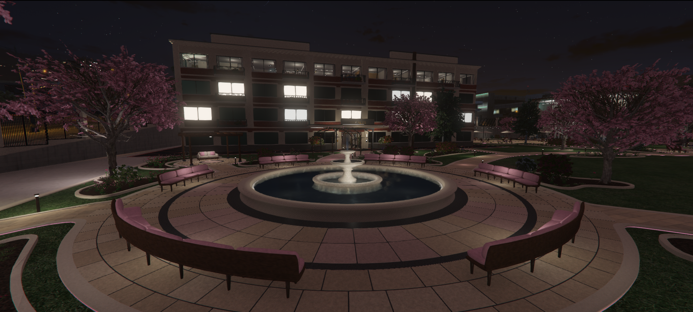
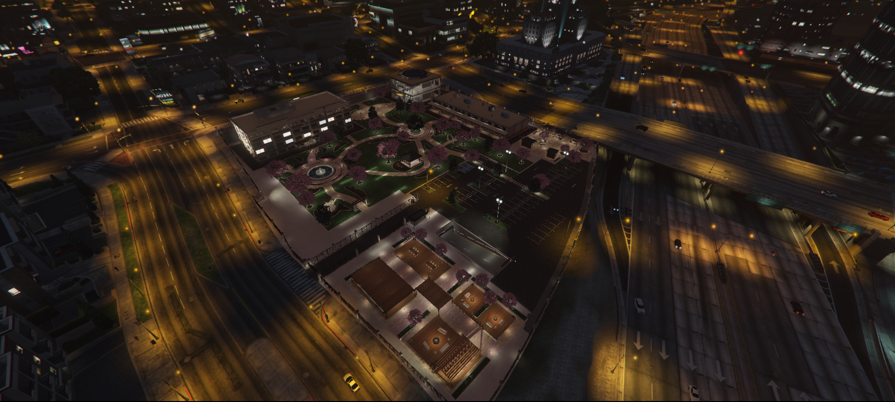
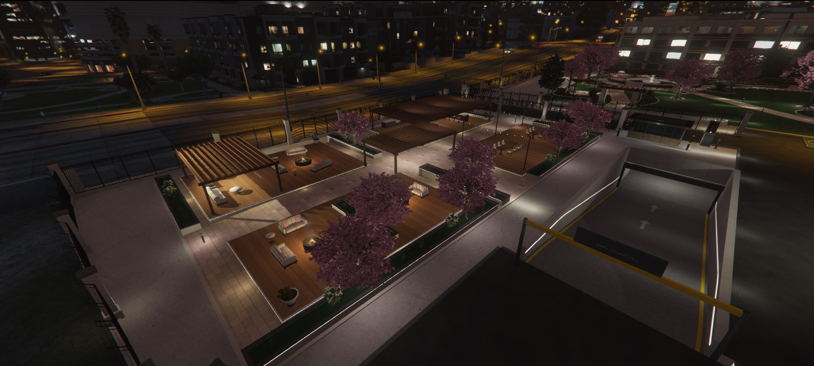

# [FREE] [MAP] Alta Commons

Welcome to Alta Commons.

Apartments, shops, offices, a rose tunnel, and far too many plushies, sitting on what used to be a perfectly good construction site.



## Download

Hit **Code → Download ZIP** to grab everything, each in its own folder.

| Folder | What's inside |
|-|-|
| **olentrix_alta_commons** | The whole map, move-in ready |
| **olentrix_alta_commons_unfurnished** | Same map, bring your own couch |
| **olentrix_alta_props** | 18 of the custom props on their own |
| **olentrix_alta_plushies** | All 94 plushies on their own |

> [!WARNING]
> Only run one map version, they're the same map and will fight.

<details>
<summary><b>Features</b></summary>

- Six walk-in top-floor apartments, each with its own style
- Strip mall, offices and an underground parking garage
- Fountain garden with a rose tunnel and outdoor dining
- Five market kiosks, including Plushy Central
- Gated perimeter with sliding gates that open as you approach

</details>

<details>
<summary><b>Installation</b></summary>

It's literally like every other FiveM map resource. Drop the folder you picked into your resources, add `ensure olentrix_alta_commons` (or `ensure olentrix_alta_commons_unfurnished`) to your server.cfg, and restart your server.

Congratulations, you now own a city block.

</details>

<details>
<summary><b>Preview</b></summary>




</details>

<details>
<summary><b>Heads up</b></summary>

This map replaces the construction site in the middle of the city. If you're running another map in that same spot, they're going to fight, and nobody wins.

```
/tp 2.72, -398.89, 38.41
```

</details>

<details>
<summary><b>License</b></summary>

Free to use and edit on your own server. No resale, re-uploading, or sharing.

</details>

Remember, feed the plushies, respect the roses, and for the love of everything holy, stop asking why your map isn't working when you forgot to ensure the resource.

Good day, you magnificent deviants.

---

| | |
|-|-|
| Code is accessible | Yes |
| Subscription-based | No |
| Lines (approximately) | 250 |
| Requirements | None, standalone |
| Support | Yes |

**Made with:** Blender 5.2 · Sollumz · CodeWalker · DirectXTex texconv
